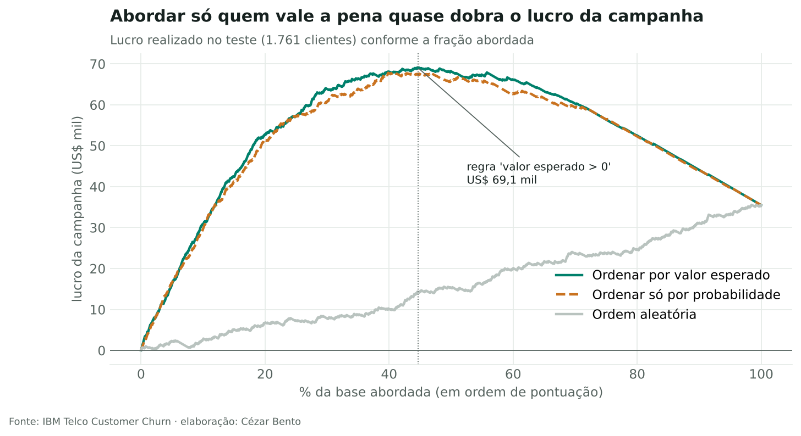
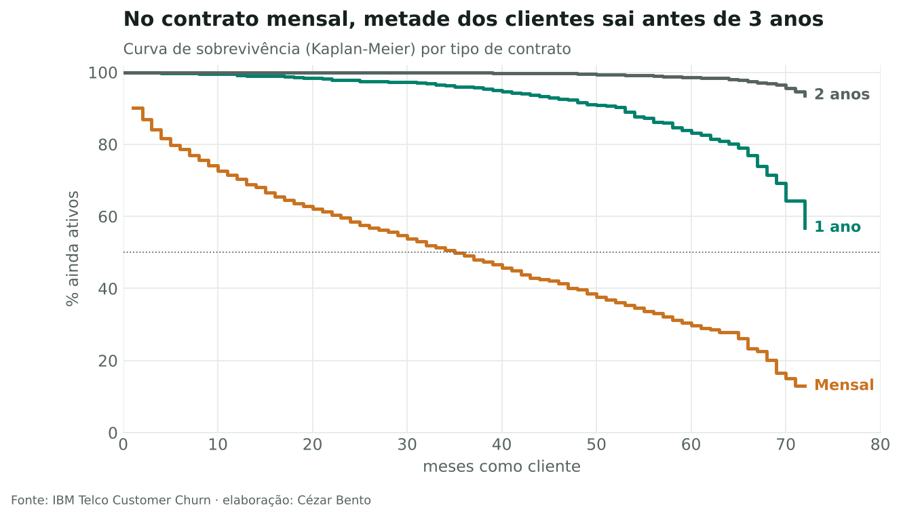

# Churn em telecom: quem vale a pena tentar reter?

**Pergunta:** a operadora tem verba para uma campanha de retenção. Quais clientes abordar para que a campanha dê lucro, e não só "acerte" quem vai sair?

**Resposta curta:** abordar apenas os clientes cujo valor esperado é positivo, ou seja, probabilidade de sair × chance de a oferta funcionar × receita preservada maior que o custo da abordagem. No teste, a regra aborda 45% da base e **quase dobra o lucro** da campanha em relação a abordar todos (US$ 69 mil contra US$ 35 mil). Se a oferta funcionar menos do que o previsto, a regra continua lucrando, enquanto abordar todos dá prejuízo.

Dados: [Telco Customer Churn](https://github.com/IBM/telco-customer-churn-on-icp4d) (IBM, Apache 2.0). São 7.043 clientes, com 26,5% de churn.

## O que tem no notebook

| Etapa | Técnica | Resultado |
|---|---|---|
| Quem sai | Taxas por segmento | Contrato mensal 43% × 2 anos 3%; fibra e boleto eletrônico concentram o churn |
| Quando sai | Análise de sobrevivência (Kaplan-Meier, implementado do zero) | No contrato mensal, metade sai em até 35 meses |
| Modelo | Regressão logística × gradient boosting, validação cruzada estratificada | Empate (PR-AUC 0,64; ROC-AUC 0,85). Fico com a logística: é mais simples e bem calibrada |
| Confiança | Curva de calibração | Quando o modelo diz 60%, saem cerca de 60% |
| Decisão | Curva de lucro com premissas explícitas e análise de sensibilidade | Regra do valor esperado > 0 |

## Premissas da campanha

US$ 50 por cliente abordado · 30% dos que sairiam ficam após a oferta · 12 meses de receita preservada. As premissas ficam em `churn.py` e o notebook mostra o efeito de variar a taxa de sucesso.

## Limitações

- Base fictícia e de um único mês. Num caso real, a validação seria temporal: treinar no passado e testar no mês seguinte.
- As premissas de custo e de sucesso precisam vir da área de negócio, idealmente medidas num teste A/B com grupo de controle.
- O modelo indica quem tende a sair, não por quê.

## Arquivos

`churn.ipynb` (análise completa) · `churn.py` (carga, Kaplan-Meier e funções da decisão) · `figuras/` · `Telco-Customer-Churn.csv`
