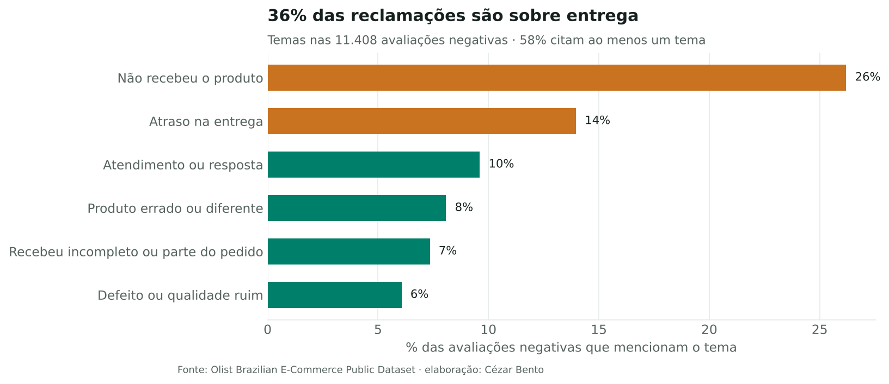
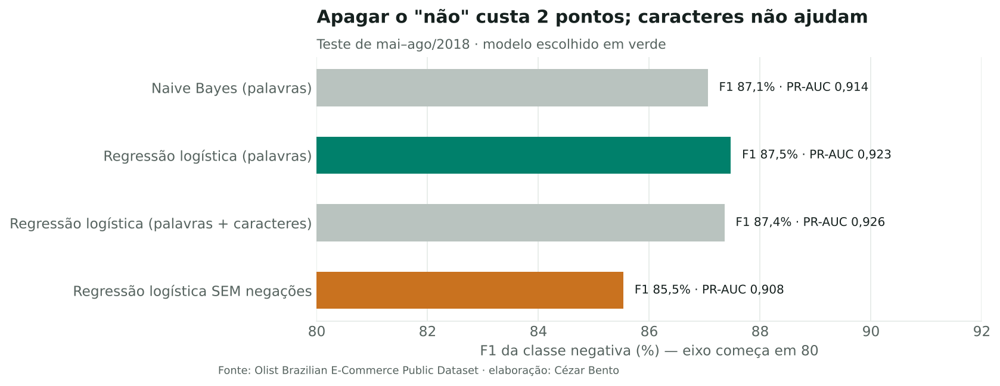
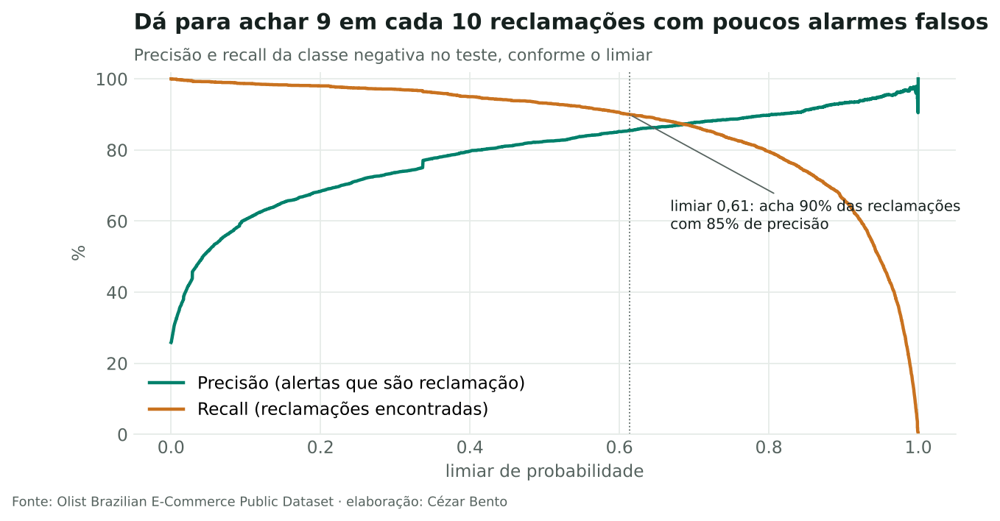

# NLP em português: o que os clientes reclamam nas avaliações?

**Pergunta:** um e-commerce recebe milhares de comentários por mês. Dá para separar automaticamente os negativos, entender do que eles falam e mandar para o atendimento só o que precisa de ação?

**Resposta curta:** sim. Um modelo simples (TF-IDF + regressão logística) identifica as avaliações negativas com F1 de 0,88 em dados de meses que ele nunca viu. Com o limiar ajustado para pegar 90% das reclamações, o atendimento revisa só 27% das avaliações, e 85% dos alertas são de fato negativos. O tema dominante é **entrega**: 36% das avaliações negativas falam de produto que não chegou ou atrasou.

Dados: 41.753 avaliações com comentário do [Brazilian E-Commerce Public Dataset by Olist](https://www.kaggle.com/datasets/olistbr/brazilian-ecommerce) (2016–2018, CC BY-NC-SA 4.0). Notas 1–2 = negativa; 4–5 = positiva; nota 3 fica de fora do treino e é analisada à parte.

## O que tem no notebook

| Etapa | Técnica | Resultado |
|---|---|---|
| Limpeza | Normalização de acentos, stopwords em português **mantendo negações** | "não recebi" continua sendo "nao recebi", e não vira "recebi" |
| Validação | Divisão temporal: treino até abr/2018, teste de mai a ago/2018 | Simula o uso real, prevendo o futuro com o passado |
| Modelos | Naive Bayes × regressão logística, com palavras e com n-gramas de caracteres | Logística com palavras: F1 0,875 · PR-AUC 0,923 |
| Prova da negação | Mesmo modelo sem as negações | F1 cai para 0,855: a escolha de pré-processamento importa |
| Interpretação | Pesos do modelo | Termos que mais puxam para negativo e para positivo |
| Temas | Regras (regex) auditáveis sobre o texto | 58% das negativas caem em pelo menos um tema |
| Decisão | Limiar escolhido por recall-alvo | Limiar 0,61: recall 90%, precisão 85%, alerta em 27% da base |
| Nota 3 | Modelo aplicado às avaliações neutras | 58% delas têm texto de reclamação: nota 3 não é "neutro" |

## Por que não um modelo de linguagem grande?

Para triagem em volume, o modelo linear treina em segundos, roda em qualquer máquina, custa quase nada por avaliação e mostra quais palavras pesaram na decisão. Um LLM entraria bem numa segunda etapa: resumir os alertas ou classificar temas mais finos do que as regras conseguem.

## Limitações

- O rótulo vem da nota, não de leitura humana: há avaliações com nota 5 e texto de reclamação, e vice-versa.
- Os temas são regras de palavras-chave; servem para priorizar, mas perdem sinônimos e ironia. O próximo passo seria rotular uma amostra e treinar um classificador de temas.
- Dados de um único marketplace e período: o vocabulário pode mudar com o tempo e precisa de monitoramento.

## Arquivos

`nlp_avaliacoes.ipynb` (análise completa) · `texto.py` (limpeza, stopwords, carga e temas) · `figuras/` · `avaliacoes_olist.csv.gz` (texto e nota, sem dados de clientes)
