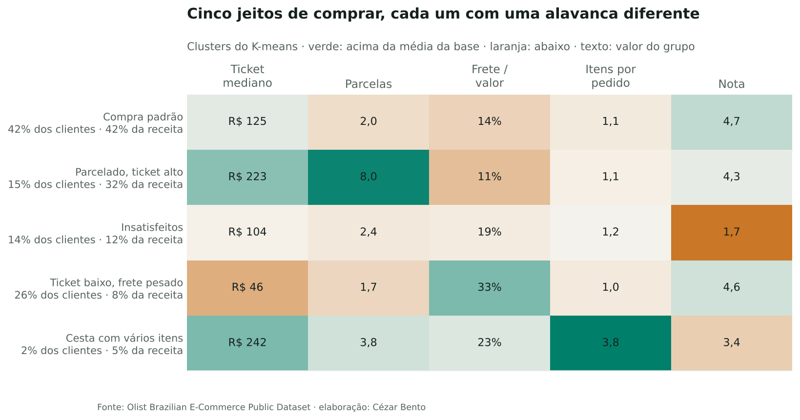
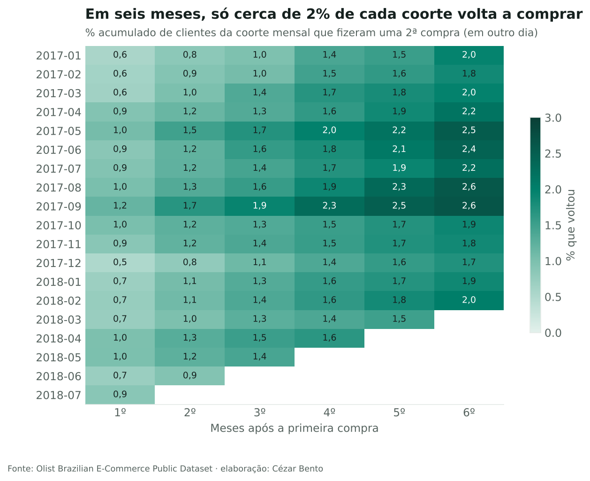
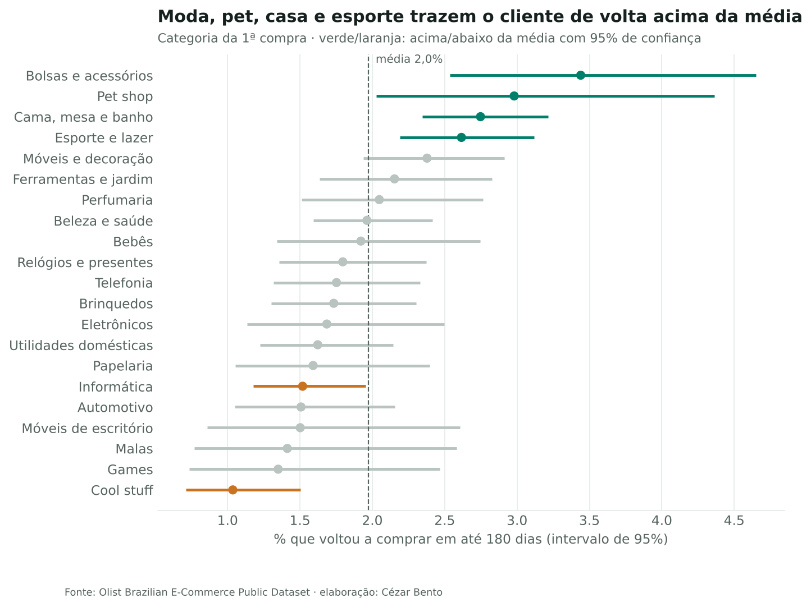

# Segmentação de clientes: RFM, clusterização e o que fazer com quem compra uma vez só

**Pergunta:** o time de CRM quer segmentar a base para personalizar campanhas. Quais grupos existem, quanto cada um vale e onde vale a pena investir?

**Resposta curta:** 98% dos clientes da Olist compraram uma única vez, e em seis meses só cerca de 2% de cada coorte volta. Com isso, o RFM clássico perde a frequência, e um modelo para prever quem volta mal supera o acaso (AUC 0,57). A segmentação útil é pelo **jeito da primeira compra**. Ela mostra que clientes **insatisfeitos** e de **frete pesado** voltam um terço menos, e que moda, pet, casa e esporte trazem o cliente de volta acima da média. Cada grupo recebe uma ação própria, a validar com teste A/B.

Dados: cerca de 96 mil pedidos entregues de 93 mil clientes do [Brazilian E-Commerce Public Dataset by Olist](https://www.kaggle.com/datasets/olistbr/brazilian-ecommerce) (2016–2018, CC BY-NC-SA 4.0).

## O que tem no notebook

| Etapa | Técnica | Resultado |
|---|---|---|
| Diagnóstico | Frequência por cliente e coortes mensais de recompra | 97,8% com uma compra; cerca de 2% voltam em 6 meses |
| RFM | Quintis de recência e valor, frequência binária | Alto valor = 30% dos clientes e 57% da receita; recorrentes = 2% e 4% |
| Clusterização | K-means com variáveis padronizadas; k por silhueta e estabilidade entre sementes (ARI) | Silhueta ≤ 0,3: não há grupos naturais. k = 5 é o melhor e é estável (ARI 0,996) |
| Recompra | Janela fixa de 180 dias, intervalos de confiança de Wilson | Insatisfeitos e frete pesado: 1,5% contra 2,2–2,4% dos demais |
| Previsão | Gradient boosting com divisão temporal e curva de ganho | AUC 0,57: campanha de retenção "mirada" seria quase aleatória |
| Validação futura | Cálculo de tamanho de amostra para teste A/B | Cerca de 14 mil clientes por grupo para detectar 2% → 2,5% |

## Os cinco grupos e a ação sugerida

| Grupo | Clientes | Receita | Ação |
|---|---|---|---|
| Compra padrão | 42% | 42% | Base de comparação |
| Parcelado, ticket alto | 15% | 32% | Crédito e produtos complementares no pós-venda |
| Insatisfeitos | 14% | 12% | Recuperação pelo atendimento (triagem do [projeto de NLP](../NLP_Avaliacoes)) |
| Ticket baixo, frete pesado | 26% | 8% | Frete grátis acima de um valor mínimo |
| Cesta com vários itens | 2% | 5% | Investigar entregas parciais |

## Decisões de método

- **Frequência em dias distintos**, não em pedidos: dois pedidos no mesmo dia costumam ser um carrinho dividido.
- **Janela de recompra igual para todos**: só entram clientes com 180 dias observados, senão os recentes pareceriam menos fiéis.
- **Recência fora da clusterização**: ela diz quando o cliente comprou, não como.
- **Nomes dos clusters por regra** (`nomear_clusters`), para não depender da numeração arbitrária do K-means.

## Limitações

- Uma loja, dois anos. Em outra base, com mais recompra, o RFM clássico funcionaria melhor.
- As fronteiras entre clusters são arbitrárias, porque os dados formam um contínuo.
- Recompra maior em pet shop é correlação (o produto acaba), não efeito de ação da empresa.

## Arquivos

`segmentacao_clientes.ipynb` (análise completa) · `segmentacao.py` (tabelas de clientes, RFM, coortes, recompra, Wilson) · `preparar_dados.py` (gera a tabela a partir dos CSVs da Olist) · `pedidos_olist.csv.gz` · `figuras/`
