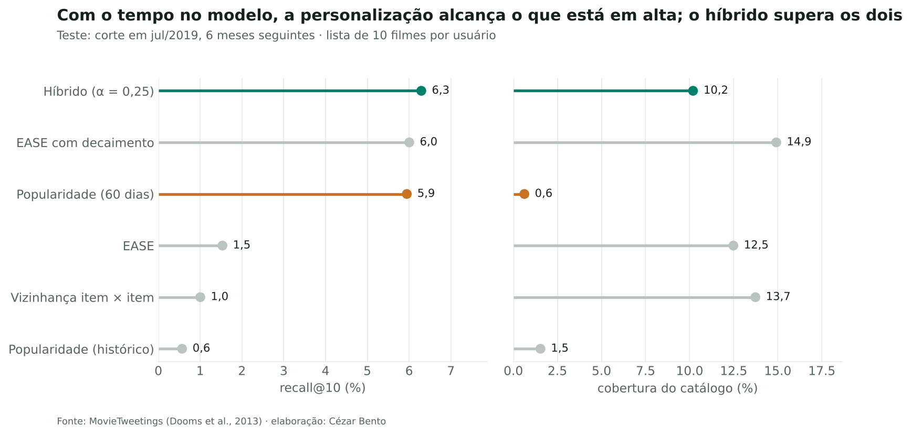
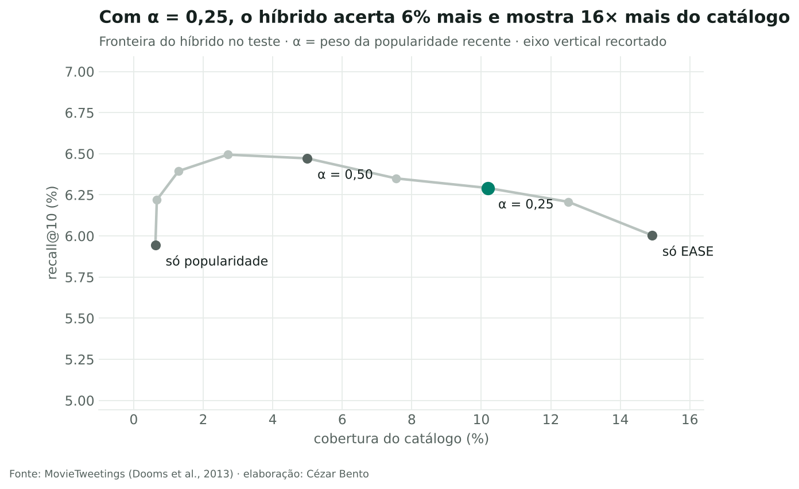
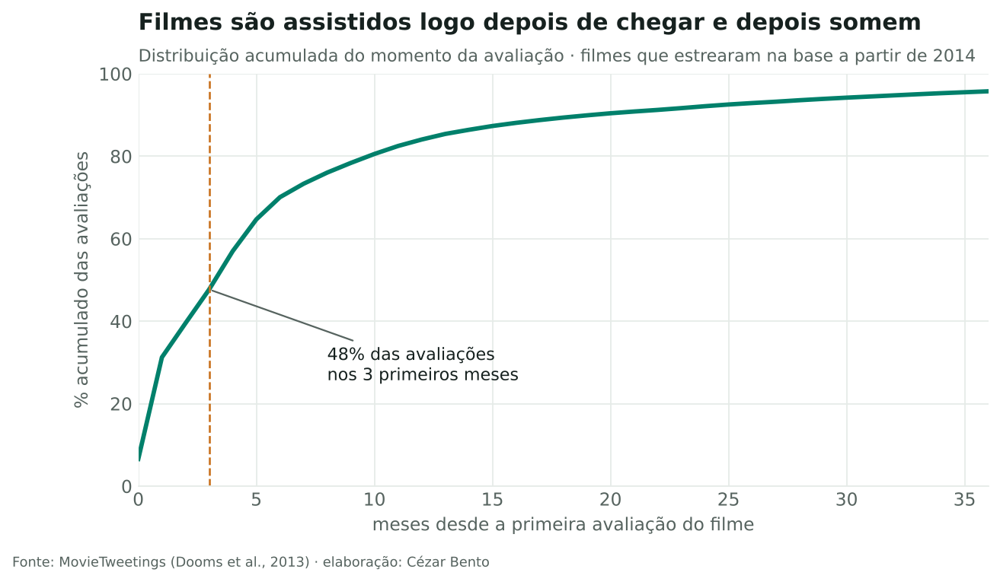

# Sistema de recomendação: personalizar ou mostrar o que está em alta?

**Pergunta:** uma plataforma quer uma lista de 10 filmes na home de cada usuário. Vale a pena um modelo personalizado, ou a lista do que está em alta já resolve?

**Resposta curta:** filmes têm prazo de validade. Metade das avaliações acontece nos três primeiros meses do filme, então modelos personalizados que ignoram o tempo acertam 4 a 6 vezes menos que a lista do que está em alta. Com **decaimento temporal**, o modelo personalizado (EASE) empata com essa lista. O **híbrido** dos dois é o único que a supera com confiança (recall@10 de 6,3% contra 5,9%, intervalo de 95% acima de zero) e mostra **16× mais do catálogo**, com uma lista diferente para cada pessoa.

Dados: [MovieTweetings](https://github.com/sidooms/MovieTweetings) (Dooms et al., 2013; licença MIT, cópia em `LICENSE_MovieTweetings.txt`), com 921 mil avaliações de filmes publicadas no Twitter de 2013 a 2021. Cada avaliação conta como "assistiu".

## O que tem no notebook

| Etapa | Técnica | Resultado |
|---|---|---|
| Comportamento | Distribuição do momento de consumo de cada filme | 48% das avaliações nos 3 primeiros meses |
| Protocolo | Divisão temporal, com validação (corte em jan/2019) e teste (corte em jul/2019) separados | 53% do que foi assistido no teste não existia no treino: teto para qualquer modelo de histórico |
| Modelos | Popularidade, vizinhança item × item, EASE (implementado do zero, solução fechada), EASE com decaimento exponencial, híbrido | — |
| Ajuste | Busca de τ e λ só na validação | Decaimento multiplica por 5 o acerto do EASE |
| Significância | Bootstrap pareado sobre usuários | Híbrido − popularidade: +0,35 p.p. (IC 95%: +0,05 a +0,63) |
| Decisão | Fronteira acerto × cobertura variando α | α = 0,25: recall 6% maior e 16× mais catálogo |
| Segmentos | Recall por faixa de histórico | O híbrido ganha em todas as faixas |

## Recomendações

1. Usar o híbrido com α baixo: o acerto fica igual ou melhor que o da lista do que está em alta, e a diversidade aumenta muito. A diversidade importa para expor o catálogo e não aparece no recall.
2. Retreinar com frequência: em consumo com prazo de validade, o tempo é a variável mais importante do modelo.
3. Para a metade do consumo que é lançamento sem histórico, o próximo passo é um modelo com atributos do filme (gênero, elenco, estreia).
4. Validar com teste A/B: recall offline mede o que a pessoa assistiu sem a recomendação, não o efeito dela.

## Limitações

- Quem tuíta sobre filmes não representa o público geral.
- Sinal implícito: nota 2 e nota 10 contam igual como "assistiu".
- O α foi fixado antes de olhar o teste. Na validação, ele custava 9% de recall; no teste, ganhou 6%. O que é estável é o padrão: pouca diferença de acerto e muita diferença de cobertura.

## Arquivos

`recomendacao.ipynb` (análise completa) · `recomendacao.py` (divisão temporal, EASE, decaimento, híbrido e métricas) · `avaliacoes.csv.gz` · `filmes.csv.gz` · `figuras/`
