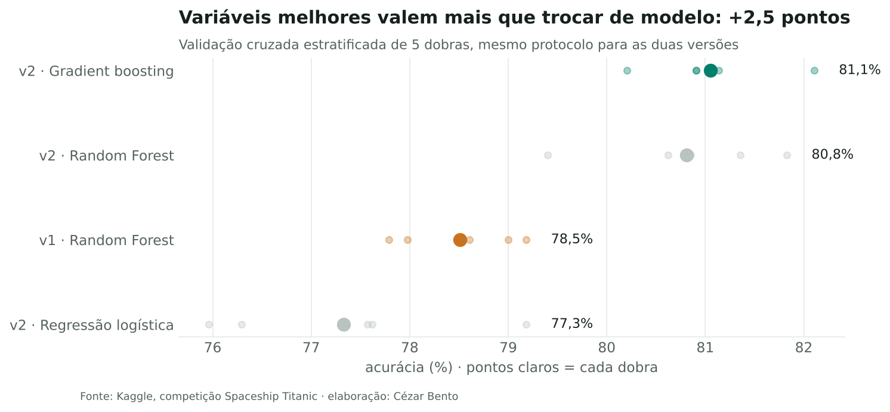
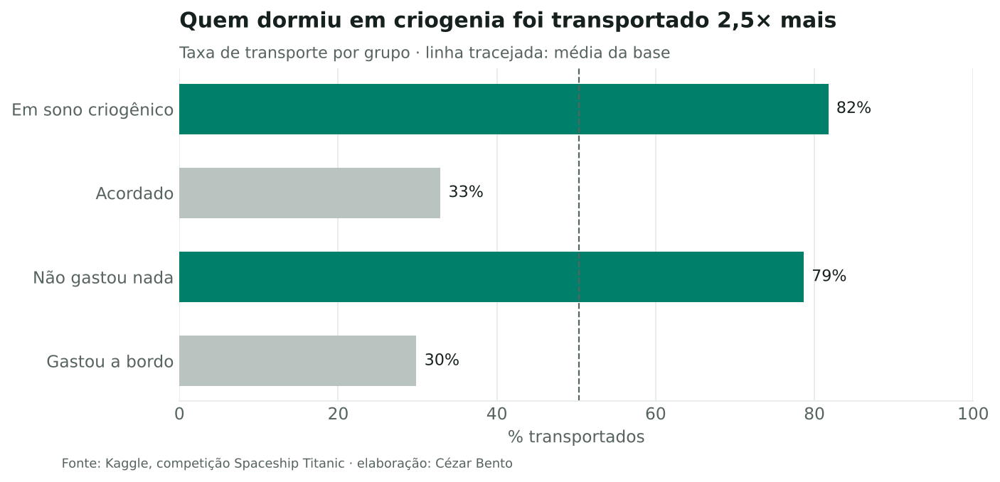

# Spaceship Titanic (Kaggle): versão 2

**Objetivo:** prever quais passageiros da nave foram transportados para outra dimensão (classificação binária), a partir de planeta de origem, cabine, idade e gastos a bordo. São 8.693 passageiros no treino.

**Resultado:** acurácia de **81,1%** em validação cruzada de 5 dobras, contra 78,5% da versão 1 no mesmo protocolo. O ganho veio das variáveis, não da troca de modelo.

## O que mudou da v1 para a v2

| | Versão 1 | Versão 2 |
|---|---|---|
| Variáveis | One-hot em tudo, inclusive ID e nome (23.742 colunas) | Grupo de viagem (do ID), deck, número e lado (da cabine), gastos em log; nome descartado |
| Ausentes | Média e moda calculadas antes de separar a validação (vazamento) | Imputação dentro do pipeline, aprendida só no treino de cada dobra |
| Gasto ausente em sono criogênico | Preenchido com a média | Preenchido com zero: quem dorme não consome |
| Validação | Uma separação de 20% | Validação cruzada estratificada de 5 dobras |
| Modelo | Random Forest | Regressão logística, Random Forest e gradient boosting comparados |

## Principais achados

- Passageiros em **sono criogênico** foram transportados 2,5× mais (82% contra 33%). O mesmo vale para quem não gastou nada a bordo.
- Em todos os decks, o lado **estibordo** foi mais transportado que o bombordo.
- Com as variáveis novas, até a Random Forest sobe de 78,5% para 80,8%. O gradient boosting acrescenta só 0,3 ponto.

## Próximos passos

- Validar por grupo de viagem (`GroupKFold`), porque membros do mesmo grupo tendem a ter o mesmo destino.
- Usar o grupo para imputar cabine e planeta de origem.

## Arquivos

`Spaceship_titanic.ipynb` (análise completa) · `features.py` (variáveis e pipeline) · `figuras/` · `submission.csv` · dados do Kaggle (`train.csv`, `test.csv`)
